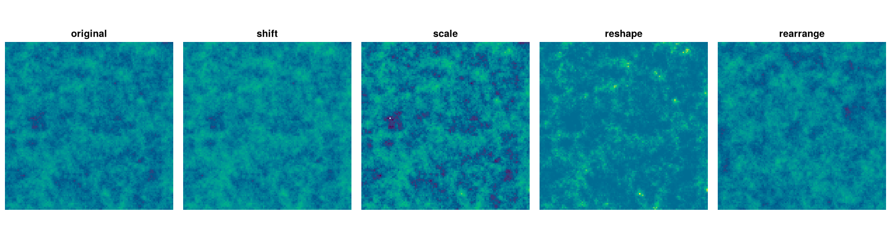
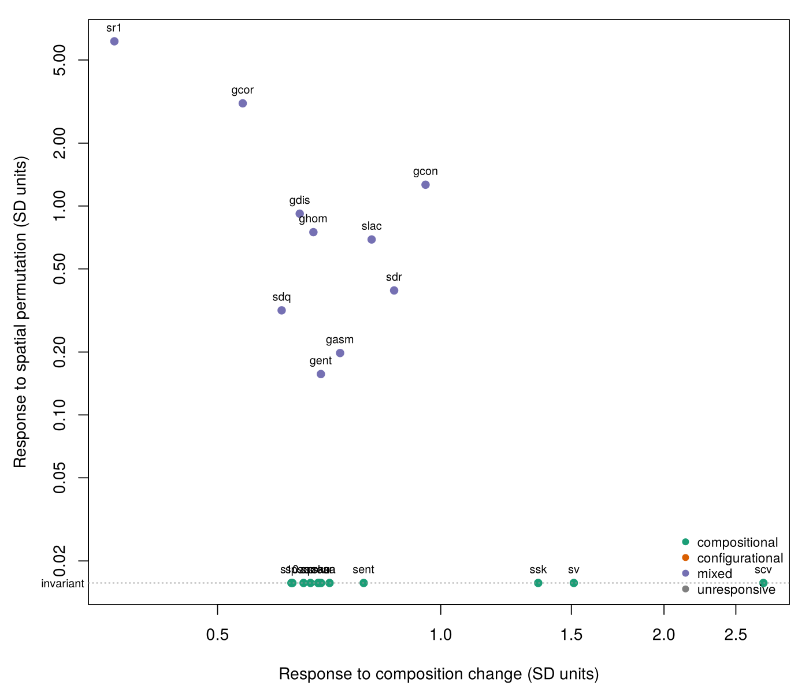
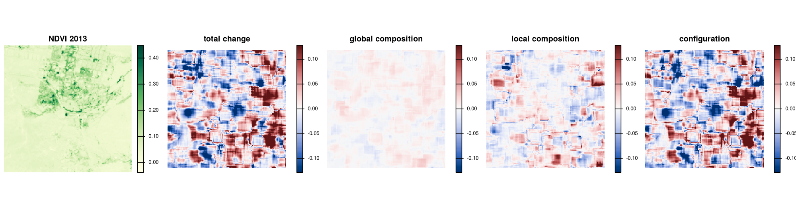
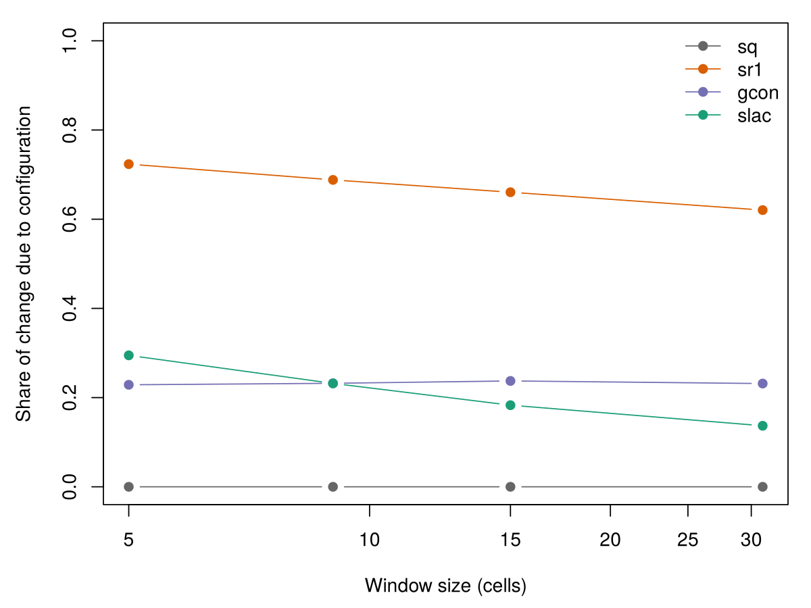

# surfscape

**Composition and configuration in continuous landscape surfaces**

`surfscape` tests whether a continuous landscape metric, computed in a
landscape window on a surface such as NDVI, canopy cover or habitat
suitability, responds to the values present in the window (composition), to
how those values are arranged in space (configuration), or to both. It applies
a battery of controlled changes to any metric, built-in or implemented in
another package, simulates landscapes with known spatial structure, and splits
the change in a metric between two dates into compositional and
configurational components.

The package is built on `terra`, with a C++ window kernel (via `Rcpp`) for its
22 built-in surface, texture, autocorrelation, entropy and lacunarity metrics.

## Installation

`surfscape` needs R (>= 4.1) and the `terra` package. It contains C++ code, so
installing from source needs a compiler: Rtools on Windows, the Xcode command
line tools on macOS.

```r
# From GitHub, latest version
install.packages("remotes")
remotes::install_github("ehsanrahimi666/surfscape")

# A specific release
remotes::install_github("ehsanrahimi666/surfscape@v0.3.0")

# From a downloaded source archive
install.packages("surfscape_0.3.0.tar.gz", repos = NULL, type = "source")
```

Check that it works:

```r
library(surfscape)
packageVersion("surfscape")
```

On Linux, `terra` needs the GDAL, GEOS and PROJ system libraries; see
<https://github.com/rspatial/terra> if its installation fails.

## Quick start (runs as-is, no files needed)

```r
library(terra)
library(surfscape)

# a Gaussian random field with a practical range of 10 cells
z <- ss_simulate(120, 120, range = 10, seed = 1)

# 100 windows of 15 x 15 cells, 39 spatial permutations per window,
# and three composition tests
b <- ss_benchmark(z, metrics = c("sq", "ssk", "sent", "sr1", "gcon", "gcor"),
                  w = 15, n = 100, nperm = 39,
                  tests = c("permute", "shift", "scale", "reshape"), seed = 1)
print(b$summary[, c("metric", "category", "configuration_response",
                    "composition_response", "signif")], digits = 3)
```

```
  metric      category configuration_response composition_response signif
1     sq compositional                   0.00                3.418      0
2    ssk compositional                   0.00                5.857      0
3   sent compositional                   0.00                3.362      0
4    sr1         mixed                   8.80                0.746      1
5   gcon         mixed                  15.33                9.608      1
6   gcor         mixed                   6.62                0.545      1
```

A metric is **compositional** when random rearrangement of the values inside
a window leaves it unchanged, **configurational** when it responds to that
rearrangement but not to any change of the values that keeps their spatial
ordering, and **mixed** when it responds to both. Responses are expressed in
standard deviations of the metric among windows; `signif` is the proportion of
windows in which the observed arrangement differs significantly from random
arrangements (two-sided, alpha = 0.05).

## The tests

| test | values present | arrangement |
|---|---|---|
| `permute` (inside each window) | kept | destroyed |
| `shift` | level changed | kept |
| `scale` | spread changed | kept |
| `reshape` | shape changed, ranks kept | kept |
| `target` | distribution of another surface | kept |
| `rearrange` (whole landscape) | kept for the landscape | changed |



## Example 1: benchmark a metric from another package

Any function that maps a window to named numbers can be tested on the same
windows. Here Moran's I and Geary's C from `terra`:

```r
moran <- function(r) c(moran = unname(terra::autocor(r, method = "moran", global = TRUE)),
                       geary = unname(terra::autocor(r, method = "geary", global = TRUE)))
bf <- ss_benchmark(z, fun = moran, fun_input = "raster", w = 15, nperm = 39,
                   tests = c("permute", "shift", "scale", "reshape"),
                   cells = b$cells, seed = 1)
print(bf$summary[, c("metric", "category", "configuration_response",
                     "composition_response", "signif")], digits = 3)
```

```
  metric category configuration_response composition_response signif
1  moran    mixed                   6.83                0.649      1
2  geary    mixed                   7.15                0.713      1
```

Both are invariant to the shift and the stretch but respond to a change in the
shape of the value distribution, so they are mixed.

## Example 2: all built-in metrics on real NDVI

The package ships 200 x 200 cell subsets of Landsat NDVI for 2013 and 2023
(western Isfahan, Iran; 30 m). The `target` test gives the 2013 surface the
2023 distribution of values while keeping its spatial ordering.

```r
z1 <- rast(system.file("extdata", "ndvi_2013.tif", package = "surfscape"))
z2 <- rast(system.file("extdata", "ndvi_2023.tif", package = "surfscape"))
bn <- ss_benchmark(z1, w = 15, n = 100, nperm = 39,
                   tests = c("permute", "shift", "scale", "reshape", "target"),
                   target = z2, skew = 0, seed = 1)
plot(bn)
```



Metrics computed from the values alone (moments, quantiles, entropy) sit on
the "invariant" line: no rearrangement of a window can change them.

## Example 3: decompose a change between two dates

`ss_decompose()` splits the change in a moving-window metric into a global
compositional component (the landscape-wide distribution of values changed), a
local compositional component (values moved between windows) and a
configurational component (values were rearranged inside windows). The three
add up to the observed change at every cell, up to floating-point rounding.

```r
d <- ss_decompose(z1, z2, metrics = c("sq", "sr1"), w = 15)
v <- values(d[[c("sr1_total", "sr1_global", "sr1_local", "sr1_config")]])
max(abs(v[, 1] - rowSums(v[, 2:4])), na.rm = TRUE)   # additivity
range(values(d[["sq_config"]]), na.rm = TRUE)        # zero for Sq
```



At the landscape level the window is the whole surface. Configurational
components of the order of 1e-15 are floating-point rounding: for metrics
computed from the values alone they are zero.

```r
print(ss_decompose_landscape(z1, z2, metrics = c("sq", "ssk", "sent", "sr1", "gcon")),
      digits = 3)
```

```
  metric value1 value2    total composition configuration share_config
1     sq 0.0467 0.0519  0.00518     0.00518     -2.43e-17     4.69e-15
2    ssk 2.6089 2.3738 -0.23509    -0.23509     -4.66e-15     1.98e-14
3   sent 1.8935 2.0022  0.10866     0.10866      0.00e+00     0.00e+00
4    sr1 0.8528 0.8489 -0.00384     0.00675     -1.06e-02     6.11e-01
5   gcon 0.8005 0.9619  0.16140     0.11329      4.81e-02     2.98e-01
```

## Example 4: window size

```r
ss_scale_profile(z1, z2, metrics = c("sq", "sr1", "gcon", "slac"),
                 w_seq = c(5, 9, 15, 31))
```



## Example 5: decomposed change around field sites

```r
pts <- read.csv(system.file("extdata", "sites.csv", package = "surfscape"))
ss_extract(d, pts, radii = c(150, 300, 600))
```

## Using your own data

```r
# Template: replace the paths with your own
library(terra); library(surfscape)
z1 <- rast("ndvi_date1.tif")      # both dates on the same grid
z2 <- rast("ndvi_date2.tif")

b <- ss_benchmark(z1, w = 15, n = 100, nperm = 39,
                  tests = c("permute", "shift", "scale", "reshape", "target"),
                  target = z2, seed = 1)
write.csv(b$responses, "benchmark_responses.csv", row.names = FALSE)

d <- ss_decompose(z1, z2, metrics = c("sq", "sr1", "gcon"), w = 15)
writeRaster(d, "decomposition_w15.tif", overwrite = TRUE)
```

Large rasters are processed in blocks of rows that overlap by half a window,
which gives the same values as a single in-memory pass. Rasters that terra
writes to disk are stored in single precision by default; call
`terraOptions(datatype = "FLT8S")` first to keep double precision. Metrics that bin values (`sent`, `srao`, `slac` and the GLCM textures)
use the joint value range of both dates by default, so that their values are
comparable between dates.

## Main functions

| Function | Purpose |
|---|---|
| `ss_benchmark()` | responses of any metric to composition and configuration tests, and its classification |
| `ss_benchmark_combine()` | pool results computed on separate windows or landscapes |
| `ss_perturb()` | the controlled changes |
| `ss_simulate()` | Gaussian random field landscapes with known structure |
| `ss_decompose()` | three-way decomposition of change in moving windows |
| `ss_decompose_landscape()` | compositional and configurational change of landscape-level metrics |
| `ss_scale_profile()` | the decomposition across window sizes |
| `ss_metrics()` | moving-window metric maps |
| `ss_rank_transfer()` | one surface's spatial ordering with another surface's values |
| `ss_extract()` | decomposed change in buffers around points |
| `ss_metric_list()` | catalogue of the built-in metrics |

## Bundled data

- `inst/extdata/ndvi_2013.tif`, `ndvi_2023.tif`: 200 x 200 cell subsets of
  Landsat NDVI, 30 m, WGS 84 / UTM zone 41N.
- `inst/extdata/sites.csv`: example site coordinates on the same grid.

## Getting help

- Help for a function: `?ss_benchmark`
- Tutorial: `vignette("surfscape")`, also as `manual/surfscape-tutorial.pdf`
- Reference manual: `manual/surfscape-manual.pdf`
- Questions and bug reports: <https://github.com/ehsanrahimi666/surfscape/issues>

## Citation

Rahimi, E. & Jung, C. (2026) surfscape: composition and configuration in
continuous landscape surfaces. R package version 0.3.0.
<https://github.com/ehsanrahimi666/surfscape>

The methods are described in a manuscript under review in *Landscape Ecology*.

## Licence

GPL-3
